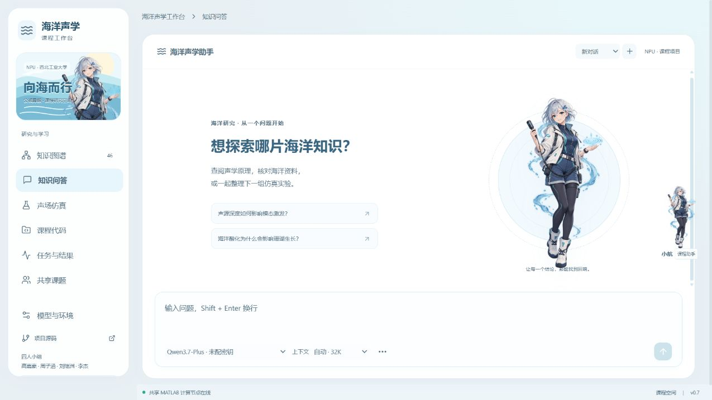

# 海洋声学工作台 / Ocean Acoustics Workbench · v0.7

用于海洋声学课程的知识图谱、模型问答与 MATLAB 声场仿真工作台。

**本项目仅用于四人小组的海洋声学课程作业与教学展示，无任何商业用途。**


## 使用与配置入口

当前公网部署为**第22版（2026-11-03）**，应用版本号仍为v0.7；代码与配置教程均位于本仓库的`main`分支。

| 你要做什么 | 从这里开始 |
| --- | --- |
| 直接使用公网网站 | [打开工作台](https://ocean-acoustics-workbench-30682.nguyenanhlan663.chatgpt.site/) → “模型与环境”选择供应商、填写自己的API Key、测试并保存。MATLAB仿真使用共享计算节点，需节点在线。 |
| 在自己电脑运行完整Agent与MATLAB | **[Windows本地完整配置教程](docs/LOCAL_SETUP.md)**：下载源码、安装依赖、初始化、API或DSH配置、MATLAB/AT与工程目录、启动、小算例及排障。 |
| 理解API、DSH与Skill如何配合 | [Agent后端与执行范围](docs/AGENT_BACKENDS.md)。本地可用API或DSH，两者共用领域Skill；公网使用API。 |
| 自行部署或维护公网版本 | [部署教程](docs/DEPLOYMENT.md)及[公共工作台与本地节点说明](docs/PUBLIC_WORKBENCH_SYNC.md)。 |

MATLAB、AT、DSH程序、私有教材和个人Key需按所选功能自行准备，不随源码下载。验证MATLAB时，先检查路径，再实际运行示例，到“任务与结果”查看成功状态、日志与输出图片；路径检查通过不等于已经运行成功。


API、DSH Harness 与领域 Skill 的实际接入方式、执行范围和选型依据见 [Agent 后端说明](docs/AGENT_BACKENDS.md)。本地完整应用默认 DSH；公共网站默认个人模型 API，两者的工具权限不同。

2026-11-03 第22版已发布：正文与控件字号放大约18%；“MATLAB 与代码”默认MATLAB，Python保留为可选辅助分析。原来打不开的28张原页引用属于未提供原件的S21–S24课件；现69知识点均有原创原理示意，并补充已核实教材页，缺原件单独提示。真实MATLAB启动自检任务7d129b357c19已通过；公网表单实际提交b091fc34424c并完成101×101声场及诊断图，见[发布复验](docs/validation/2026-11-03/deployment-v22.json)和[实测记录](docs/validation/2026-11-03/graph-matlab-ui-checks.json)。

公网Agent通过共享计算节点运行受控MATLAB/AT仿真，不会自动操作访问者电脑；本地完整工作台使用本机MATLAB与授权项目目录。路径检测只确认程序和输入文件存在；实际可用以“任务与结果”的成功状态、日志和输出文件为准。

2026-11-03 第21版已正式发布图谱多选与代码工作台；公网浏览器实际运行Python、保存/刷新恢复、JSON/PNG/源码下载通过。本机服务同步更新，Skill驱动仿真与模型修码实测见[部署与复测回执](docs/validation/2026-11-03/deployment-v21.json)。

2026-11-03 第20版精简图谱详情的来源定位卡片，保留知识讲解、图片与关联。当前资料接入属于知识卡、RAG和Skill，没有对供应商模型进行领域蒸馏或微调；实际实现与可选训练路线见[知识接入与模型训练状态](docs/KNOWLEDGE_TRAINING_STATUS.md)。

2026-11-03 正式网站第19版修复[地图选点后数据难以发现](docs/validation/2026-11-03/ocean-point-display.md)：地图旁直接显示温盐声速概要，普通滚轮恢复页面滚动。已核查云端17期数据和印度洋等3点的真实剖面；第18版模型连接修复也已由用户确认有效Key“调用通过”，见[API验收记录](docs/validation/2026-11-03/api-connection-diagnosis.md)。

本轮已实际验证图谱多选带入对话、真实DSH工具调用、Skill驱动Munk仿真、模型修改代码及读取真实运行结果，以及浏览器Python/NumPy绘图、停止和超时；修复了聊天回答不显示、隔离线程启动失败、仿真参数被静默替换与错误成功提示。范围与实测证据见[功能验收状态](docs/DUAL_WORKBENCH_ACCEPTANCE.md)。

2026-11-03 [实际功能验收与修复](docs/FUNCTIONAL_VALIDATION_2026-11-03.md)：已发布第17版，真实跑通三模型表单、八种本地配方、四季双判据诊断及公网新任务；DSH只读工具链已通过，自主诊断归档两次未通过，真实API对照仍待有效配置。不把执行器成功冒充Agent自主研究成功。

2026-11-02 本地科研 Agent 科学性增强：统一研究 Skill 的比较与证据规则，新增标准剖面诊断、指定区域声场数值比较和任务只读审核；结果页分开展示执行状态、程序检查与 Agent 自评，输入或方法版本改变后旧检查需重做。程序检查不等于物理精度认证。使用方法、公共端适用范围与验证见[科研检查说明](docs/RESEARCH_SCIENCE_VALIDATION.md)。

2026-11-01 海洋数据在线化：新增[数据工作台入口](https://ocean-acoustic-data-workbench.huuiihhuuiii.chatgpt.site/)，复用现有网页导航，提供全球 WOA18 全部 17 个时期的温盐/声速剖面与 ETOPO1 可缩放选点地图。浏览器按需查询，无需下载老师的原始资料包；数据查询独立于 MATLAB 节点。本地研究 Agent 可通过 `OCEAN_DATA_URL` 使用同一数据接口。转换、校验、发布和能力边界见[云端海洋数据部署说明](docs/CLOUD_OCEAN_DATA.md)。完整数据是否已激活以在线 `/api/ocean-data` 为准。



2026-10-15 更新：采用 Fuwari 风格改编与 Sakana 动画核心，配合原创透明海洋研究员插画；新增公网 SSE 真实流式回答、独立持久会话、Sites 账户个人空间和小组共享课题。知识检索增加有语境的口语改写、RRF 与时空数值证据门控；五份授权 PDF 按保留 Unicode 的入库格式2重建，1789 / 1846 页、4101 个片段，57 页等待复核。仿真支持持久化队列、幂等提交和真实结果对比。见 [v0.7 验收](docs/VALIDATION_V0_7.md)与[知识质量说明](docs/KNOWLEDGE_QUALITY.md)。

在线站点：[海洋声学工作台](https://ocean-acoustics-workbench-30682.nguyenanhlan663.chatgpt.site/)。GitHub 源码、当前构建产物与该地址实际部署版本分别管理；合并源码不会自动发布。下述统一版能力以本分支实现为准，实际线上启用范围须以部署和验收记录确认。历史 v0.7 公网界面为 46 个知识点、126 条关系与固定 Munk KRAKEN/FIELD，本次将本地增强界面和受限公共工具统一接入，不能用旧截图判断新版能力。

## 当前源码：统一工作台

- **课程图谱**：6 个课程单元、69 个知识点、180 条有类型关系，提供目录、关联查询、学习路径、公式、示意图和来源。图谱与公开来源不需要模型 Key；关联连接不等于物理因果。
- **对话工作台**：默认使用本人配置的模型 API 作为研究 Agent，加载 Skill、检索资料、查询真实环境数据、调用当前允许的工具并展示调用记录。支持会话改名/删除、聊天导出/清空/撤销、问题换一组及任务导入；公共站不接入本机DSH/Codex；Python可在隔离浏览器中显式运行，服务器不执行访客任意Python/MATLAB脚本。
- **可恢复研究请求**：`POST /api/research/chat` 创建幂等请求，`POST /api/research/runs/ID/step` 分步推进模型决策与工具调用，`GET /runs/ID` 只读取状态。公共研究页默认 0 轮和不限应用上下文预算；0 表示不限轮次，仍保留重复调用防护、停止操作和供应商限制。断线后继续已有请求，不自动重发问题或重复提交计算。该研究流程不是历史课程问答的 SSE 文本流接口。
- **模型配置**：保留 DeepSeek、阿里云百炼、Moonshot Kimi、智谱 GLM 的 16 个模型预设，模型设置继续使用原有个人空间及 Key 协议。预设不表示账户已开通权限；需要本人有效 Key、额度与相应模型权限。旧课程问答的 SSE、输入预算和消息接口仍保留，不把其历史界面控件冒充研究 Agent 新增能力。
- **模型经验与技能**：12 个 Skill 入口、9 类模型经验和 8 个已固化的经典创建配方，展示适用条件、ENV/FLP、调用链和历史算例；KRAKEL 基线创建仍未开放。资料条目、配方可创建、程序可运行、收敛及物理精度分别判断，不能称为九种模型全部在线运行。
- **声场配置与执行**：公共适配界面提供 KRAKEN、SCOOTER、BELLHOP 三模型，Munk、Pekeris、WOA18 及经典验证环境；单次、源深/季节等分析受实际模型和参数限制。检查计划、提交与真实求解需要已授权且在线的专属节点；节点离线时明确禁用执行，资料和参数仍可浏览。固定表单提交使用幂等标识，任务与结果按访客归属隔离。
- **海洋数据与诊断**：全球 WOA18 全部 17 个时期温盐/声速剖面、ETOPO1 缩放地图和选点、CSV/JSON 导出；浏览器无需下载原始整包。研究工具可做单点四季温度阈值混合层与候选近表层声道诊断；当前公共诊断不计算密度 MLD，也不把单点气候态冒充区域统计或瞬时观测。传播验证另需声场计算。
- **任务与项目文件**：任务日志、结果图表、验证信息、下载和导入对话；节点允许时删除本人任务及其输出文件。公共站隐藏全局队列管理和打开本机目录，用在线文件列表/下载访问产物。项目文件按程序、模型输入、图表数据、说明日志和测试分类，仅展示允许共享的代码、Skill 和算例快照，不公开维护者的磁盘。
- **个人与小组空间**：保留 Sites 登录后的跨设备个人配置/会话、匿名 Cookie 隔离、邀请加入课题和显式笔记/来源共享。Key、私人对话与共享笔记继续在 D1 加密保存；课题不因此共享模型 Key、私人会话或私有教材。
- **资料检索**：30 篇 NOAA 正文与 9 条项目导读，共 39 个可检索来源、67 个片段；动态登记入口不等于已接实时数据。BM25、双语词表、语境改写和 RRF 提供引用候选，缺乏匹配观测时不编造具体海况。授权教材全文与原页仍依赖相应资源/节点；历史入库为五份 PDF 的 1789 / 1846 页、4101 个片段，57 页待复核，不表示公式和表格已全面验证。

本地完整应用仍可使用 DSH、本机 Codex、模型 API 和受信任的 Python/MATLAB 研究脚本；这些本机权限没有随界面复制而开放给公共访客。构建同步方式、节点连接和验收边界见 [统一版同步说明](docs/PUBLIC_WORKBENCH_SYNC.md)。当前图谱/Skill 在生产构建时由本地源码生成脱敏公共快照，公共 UI 则维护云端协议适配层，避免再次把两个应用目录当成同一部署入口。

## 仓库结构

```text
ocean-acoustic-public/       React 网页、云端 Worker、D1 迁移与构建脚本
ocean-acoustic-workbench/    本地完整工作台、FastAPI 网关、MATLAB 执行器和测试
docs/DEPLOYMENT.md           部署步骤、环境变量与验证
docs/OPEN_OCEAN_KNOWLEDGE.md  公开知识来源、许可、独立索引与刷新
LICENSE                     本项目原创程序的 MIT 许可证
NOTICE.md                   外部教材、MATLAB 和 AT 的权利说明
```

## 本地启动

完整教程见[本地安装、模型 API/DSH、MATLAB/AT 配置与小算例](docs/LOCAL_SETUP.md)。基础界面和公开图谱需要 Python 3.12+、Node.js 22.13+；模型生成需要本人配置模型服务；声场仿真再配置获授权的 MATLAB 和 AT。原始课程资料不随本仓库分发。

```powershell
cd ocean-acoustic-workbench
python -m venv .venv
.\.venv\Scripts\python.exe -m pip install -r backend/requirements.txt
npm.cmd ci
npm.cmd run build
.\.venv\Scripts\python.exe backend/init_local.py
.\start.ps1
```

本地默认网址 `http://127.0.0.1:8765/`。有课程资料包时，按完整教程额外运行 `bootstrap.py` 与 `install_toolbox.py` 导入教材和完整 AT；没有资料包也可以先使用公开图谱与 API 问答。在环境设置中填写 MATLAB 可执行文件、AT 及项目目录，再检查运行环境。AT 安装脚本默认使用当前用户的 Documents/MATLAB 目录。

公网部署请阅读 [部署文档](docs/DEPLOYMENT.md)。`.local`、真实 API Key、私有数据库、求解结果、教材 PDF、原始压缩包以及生产站点身份不提交 Git。经审核的 NOAA 公有领域文字片段与项目自写导读放在公共 JSON 中，保留上游来源与许可说明。

## 验证与边界

当前检查范围与记录见 [v0.7 验收](docs/VALIDATION_V0_7.md)；此前公网访问、MATLAB、图片与结果包记录保留在 [v0.6 验收](docs/VALIDATION_V0_6.md)。模拟供应商测试覆盖 SSE、停止、截断、会话幂等、账户隔离与共享权限；本轮没有用真实付费 Key 生成答案，不把模拟响应当供应商质量测试。

```powershell
cd ocean-acoustic-workbench
.\.venv\Scripts\python.exe tests/test_models.py
.\.venv\Scripts\python.exe tests/test_knowledge.py
.\.venv\Scripts\python.exe tests/test_knowledge_quality.py
.\.venv\Scripts\python.exe tests/test_public_ocean.py
.\.venv\Scripts\python.exe tests/test_context_budget.py
.\.venv\Scripts\python.exe tests/test_local_chat_safety.py
.\.venv\Scripts\python.exe tests/test_science.py
.\.venv\Scripts\python.exe tests/test_plans.py
.\.venv\Scripts\python.exe tests/test_persistence.py
.\.venv\Scripts\python.exe tests/test_simulation.py
.\.venv\Scripts\python.exe tests/test_simulation_api.py
.\.venv\Scripts\python.exe backend/evaluate_knowledge.py
# 以下检查需要本地服务、教师资料及至少一次成功仿真：
.\.venv\Scripts\python.exe tests/check_local.py
.\.venv\Scripts\python.exe tests/check_references.py
```

云端会话、账户/课题、SSE、模型选择、公开知识和上下文预算检查：在 `ocean-acoustic-public` 运行 `npm.cmd ci` 与 `npm.cmd test`；离线检索基准运行 `node scripts/evaluate-knowledge.mjs`。题集用于开发调参，不是盲测，不能把召回结果称为100%回答准确率。历史全文验收保留在 [v0.5 记录](docs/VALIDATION_V0_5.md)。

云端供应商请求已修复 workerd 重定向参数兼容问题，明确区分认证、余额、网络和超时错误。原因与认证层验证见[模型连接记录](docs/MODEL_CONNECTION.md)；无效测试 Key 收到 401 只能证明到达认证层，不能代替有效账户的生成质量测试。

知识图谱关联不等于因果证明，Munk 示例不代表真实海域，入库页覆盖率不是知识正确率。官方来源清单刷新已实现；实时观测 API、通用实时全网搜索、向量模型、OCR、自动实体关系抽取与模型训练尚未接入。公共站提供隔离浏览器Python，不开放服务端任意代码执行或自动修改本机MATLAB项目；本地受信任研究脚本执行不等于公开安全沙箱。知识不会永久写进供应商模型；私有原文、索引与 Key 不随源码分发。

私有资料接入步骤见[知识入库说明](docs/KNOWLEDGE_IMPORT.md)。直接复用的 BM25 评分器与方法参考项目分别说明在 [NOTICE](NOTICE.md)；借鉴方法不表示已安装 LightRAG、RAGFlow、LlamaIndex 或 Haystack 完整框架。

公共聊天的模型选择与配置入口参考 [WorkBuddy 官方模型配置文档](https://www.codebuddy.ai/docs/workbuddy/From-Beginner-to-Expert-Guide/Function-Description/Model)，没有移植其产品、角色或 Agent 实现。供应商缓存是另一层机制，参见 [DeepSeek 缓存说明](https://api-docs.deepseek.com/zh-cn/guides/kv_cache/)与[阿里云百炼缓存说明](https://help.aliyun.com/zh/model-studio/context-cache)；本项目仅读取实际返回的缓存用量，不承诺命中率或控制供应商 KV cache。


## 自然语言仿真

本地完整应用已整合自然语言仿真代理、声学基准 Cookbook、Python/MATLAB 脚本、解析射线、交互式 MATLAB 环境检测和图表放大。其 `/api/simulation/chat` 仍属于本地授权执行范围；公共统一版通过受限三模型表单及研究工具提交，不开放本地任意代码入口。

## 两个开发分支的统一版本（2026-11-01）

`feature/natural-language-agent` 与 `feature-research-agent` 已整合到同一个本地工作台，入口仍在 `ocean-acoustic-workbench/`。研究分支原来位于仓库根目录的文件已归入这个目录，不需要启动第二套应用。

- **对话工作台**：切换研究代理、自然语言仿真和课程问答。
- **共享配置与结果**：沿用同一份本地配置和数据库；研究任务、解析射线、动态 Python/MATLAB 脚本与固定模板仿真都在“任务与结果”中查看。
- **研究功能**：保留九类模型资料、WOA18 海洋数据、研究技能、独立会话管理、项目文件与报告。
- **启动**：按本地工作台 README 安装 Python 依赖，在该目录运行 `npm ci`、`npm run build`，然后运行 `start.ps1`。已有安装也需要更新依赖并重新构建。

公共应用 `ocean-acoustic-public/` 维护云端适配 UI，与本地应用共用生成后的图谱/Skill 来源；本次 Git 合并不自动发布线上网站，也不分发本机 MATLAB、Acoustics Toolbox、私有课件或模型密钥。更新公共资源须走构建同步并另行部署，见 [同步说明](docs/PUBLIC_WORKBENCH_SYNC.md)。
