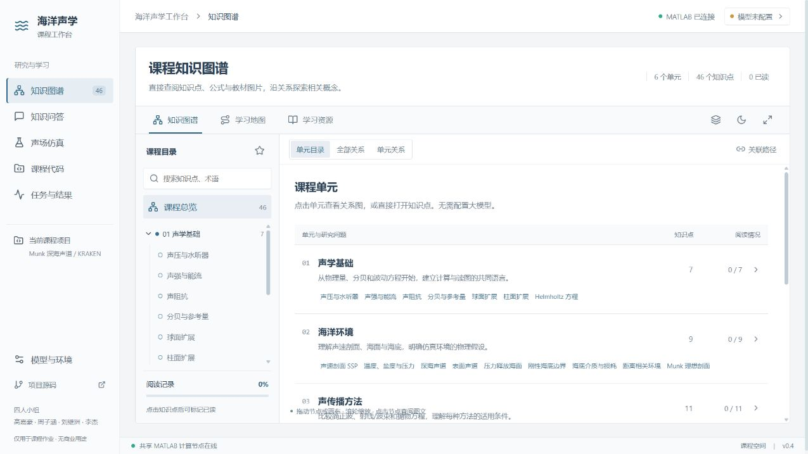

# 海洋声学工作台 / Ocean Acoustics Workbench

用于海洋声学课程的知识图谱、模型问答与 MATLAB 声场仿真工作台。

**本项目仅用于四人小组的海洋声学课程作业与教学展示，无任何商业用途。**

2026-10-13 更新：界面参考 JupyterLab / VS Code 的紧凑科研工作区；知识库加入 BM25、术语别名、原页片段和有类型的课程关系。实际采用与未采用的开源技术分别记录在 [界面设计与复用](docs/DESIGN_AND_REUSE.md)、[知识入库与检索](docs/KNOWLEDGE_AND_RETRIEVAL.md)、[仿真与验证](docs/SIMULATION_AND_VALIDATION.md)。

在线演示：[海洋声学工作台](https://ocean-acoustics-workbench-30682.jovial-sun-4182.chatgpt.site/)。图谱和模型问答在云端运行；MATLAB 仿真与私有原文索引需要项目计算节点在线。

## 当前功能

- 6 个课程单元、46 个知识点、126 条有类型的关系；目录、关联查询、学习路径、原理示意图和引用。
- DeepSeek、阿里云百炼、Moonshot Kimi、智谱 GLM 的 16 个具体模型预设；用户使用自己的 API Key。
- Munk 深海模板，MATLAB R2024a + AT KRAKEN/FIELD 真实计算；队列、日志、传播损失图片、CSV 和结果包。
- 公网访客的模型配置、对话和任务隔离；公共 Agent 只分析课程共享代码，不操纵访客设备。
- 模型密钥与对话按访客加密保存到 D1；支持清除全部模型密钥。更换浏览器或清除 Cookie 会建立新访客空间。
- 授权 PDF / DOCX / TXT / Markdown 私有分块入库、SHA256 版本与原页引用；三份课程来源的 38 个引用页已形成 90 个私有片段，未把原文上传 GitHub。
- 12 道课程命题（9 道参数预设、3 道条件与工具边界题）；输入输出一致性校验、结果数值分析和 manifest 文件哈希。
- 云端图谱与页面、D1 请求队列、R2 响应/图片存储，以及计算节点主动发起的加密 HTTPS 连接。

## 仓库结构

```text
ocean-acoustic-public/       React 网页、云端 Worker、D1 迁移与构建脚本
ocean-acoustic-workbench/    本地完整工作台、FastAPI 网关、MATLAB 执行器和测试
docs/DEPLOYMENT.md           部署步骤、环境变量与验证
LICENSE                     本项目原创程序的 MIT 许可证
NOTICE.md                   外部教材、MATLAB 和 AT 的权利说明
```

## 本地启动

需要 Python 3.12+、Node.js 22.13+、获授权的 MATLAB，以及课程资源包或自己准备的 AT 环境。原始课程资料不随本仓库分发。

```powershell
cd ocean-acoustic-workbench
python -m venv .venv
.\.venv\Scripts\python.exe -m pip install -r backend/requirements.txt
npm.cmd ci
npm.cmd run build
.\.venv\Scripts\python.exe backend/bootstrap.py "你的资料包路径.zip"
.\start.ps1
```

本地默认网址 `http://127.0.0.1:8765/`。在环境设置中填写 MATLAB 可执行文件、AT 及项目目录，再检查运行环境。AT 安装脚本默认使用当前用户的 Documents/MATLAB 目录。

公网部署请阅读 [部署文档](docs/DEPLOYMENT.md)。`.local`、真实 API Key、数据库、求解结果、教材 PDF、原始压缩包以及生产站点身份不提交 Git。

## 验证与边界

已经完成真实公网验证：匿名访问、访客隔离、教材图片、知识检索、MATLAB 作业、结果 PNG 与 ZIP 下载。离线模型测试覆盖请求参数和密钥隔离；真实供应商调用需要有效密钥、额度及模型权限，未使用维护者的付费密钥进行验证。

```powershell
cd ocean-acoustic-workbench
.\.venv\Scripts\python.exe tests/test_models.py
.\.venv\Scripts\python.exe tests/test_knowledge.py
.\.venv\Scripts\python.exe tests/test_science.py
.\.venv\Scripts\python.exe tests/test_plans.py
# 以下检查需要本地服务、教师资料及至少一次成功仿真：
.\.venv\Scripts\python.exe tests/check_local.py
.\.venv\Scripts\python.exe tests/check_references.py
```

云端访客配置、加密隔离和离线检索检查：在 `ocean-acoustic-public` 运行 `npm.cmd ci` 与 `npm.cmd test`。本轮检查记录见[版本验证记录](docs/VALIDATION_V0_4.md)。

知识图谱中的概念关联不等同于因果推导；Munk 示例不代表某一真实海域。完整教材图片由部署者自行提供，仓库只保留原理示意图和引用信息。当前未实现账号登录、跨设备历史同步、任意 MATLAB 代码执行或自动修改项目。



私有资料接入步骤见[知识入库说明](docs/KNOWLEDGE_IMPORT.md)。
