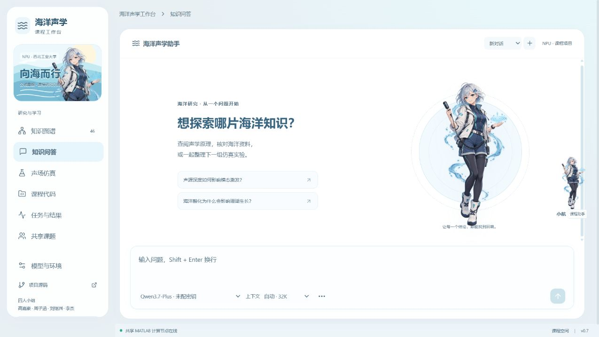

# 海洋声学工作台 / Ocean Acoustics Workbench · v0.7

用于海洋声学课程的知识图谱、模型问答与 MATLAB 声场仿真工作台。

**本项目仅用于四人小组的海洋声学课程作业与教学展示，无任何商业用途。**



2026-10-15 更新：采用 Fuwari 风格改编与 Sakana 动画核心，配合原创透明海洋研究员插画；新增公网 SSE 真实流式回答、独立持久会话、Sites 账户个人空间和小组共享课题。知识检索增加有语境的口语改写、RRF 与时空数值证据门控；五份授权 PDF 按保留 Unicode 的入库格式2重建，1789 / 1846 页、4101 个片段，57 页等待复核。仿真支持持久化队列、幂等提交和真实结果对比。见 [v0.7 验收](docs/VALIDATION_V0_7.md)与[知识质量说明](docs/KNOWLEDGE_QUALITY.md)。

在线演示：[海洋声学工作台](https://ocean-acoustics-workbench-30682.jovial-sun-4182.chatgpt.site/)。图谱和模型问答在云端运行；MATLAB 仿真与私有原文索引需要项目计算节点在线。

## 当前功能

- 6 个课程单元、46 个知识点、126 条有类型的关系；目录、关联查询、学习路径、原理示意图和引用。
- DeepSeek、阿里云百炼、Moonshot Kimi、智谱 GLM 的 16 个具体模型预设，显示供应商、模型名称、API 标识与端点；聊天内快切复用本人已配置的供应商 Key，并记录请求模型与实际响应标识。预设不表示账户已开通模型权限。
- 公网聊天直接转发供应商 SSE 文本增量，支持停止；连接中断与失败不伪装为完整回答，供应商输出截断会保留状态。独立对话各有历史，消息加密分行保存，重试通过请求标识避免重复生成。
- 公共聊天默认“资料 + 模型知识”（`general`）；可在“更多”切换“仅依据资料”（`course`）。资料范围包括课程证据和公开网页快照；模型一般知识单独标注，未命中资料的问题进入访客私有缺口记录，不自动成为正式知识或触发训练。
- 主问答与“小航”共用输入框控件。4K、8K、16K、32K、64K、128K 控制实际发送的输入预算，自动为 32K；服务端按保守估算裁剪历史和资料。它不调整模型原生窗口或 KV cache；实际输入及缓存命中以供应商返回为准。
- 公开索引含30篇NOAA正文与9条自写导读，39个可检索来源、67个片段；42项登记中3项为尚未接通的动态入口。覆盖酸化、珊瑚、海平面、海流、浮标、海啸、质控等主题，中文标题与导读由项目整理；点击图谱“学习资源”即可查看来源、时间与许可，无需Key。
- 计算节点启动与状态查询按 168 小时 TTL 检查 30 篇 NOAA 正文并调度后台刷新，失败保留上次成功快照，只更新独立私有网页快照；9 条项目导读与 3 个数据入口由维护者更新登记。云端内置公开索引离线可检索，更新该静态包需导出、构建和重新发布。
- 原创海洋助手“小航”：透明插画、Sakana 核心驱动的互动动画与浮动聊天，和主问答共用状态；Fuwari 改编样式与动画核心保留 MIT 许可，不使用上游内置动漫角色或官方 Logo。
- Munk 深海模板由 MATLAB R2024a + AT KRAKEN/FIELD 真实计算；支持参数草案、预览后确认、持久化队列、幂等提交、任务日志、传播损失图片、CSV 和结果包。自然语言只提取显式参数并报告缺项，不自动运行或执行生成代码。
- 成功任务可做 2–4 组结果对比，先检查环境、网格、参考约定与产物哈希；不把不可比条件的曲线或彩图用作海域排名。
- 公网访客的模型配置、对话和任务隔离；公共 Agent 只分析课程共享代码，不操纵访客设备。
- Sites 平台登录身份提供个人空间，可跨设备读取本人持久会话与配置；匿名空间继续由浏览器 Cookie 隔离，登录时不自动合并匿名历史或 Key。小组课题通过邀请共享明确提交的研究笔记与来源链接，不共享模型 Key、私人对话或私有教材。
- 模型密钥、会话内容和共享笔记在 D1 加密保存，支持清除本人模型密钥。应用不收集平台登录密码，不把维护者 Key 提供给访客。
- 授权 PDF / DOCX / TXT / Markdown 私有分块入库，保留来源、页码、字符位置与 SHA-256。S01 / S07 / S15 / S17 / S18 已逐页处理 1846 页，1789 页形成4101个片段，57页为空/短文本待复核。显示原文保留 Unicode，检索归一化单独保存；未做 OCR 或公式/表格全面核验。
- BM25、双语术语与人工语境改写、有界图谱上下文和实际 RRF 融合；资料是引用候选，不等于答案已获证明。具体时间、海域、深度的数值缺少匹配观测时明确拒绝冒充实测；60题无Key基准检查召回、来源定位与缺证据门控。
- 12 道课程命题（9 道参数预设、3 道条件与工具边界题）；输入输出一致性校验、结果数值分析和 manifest 文件哈希。
- 云端图谱与页面、D1 请求队列、R2 响应/图片存储，以及计算节点主动发起的加密 HTTPS 连接。

## 仓库结构

```text
ocean-acoustic-public/       React 网页、云端 Worker、D1 迁移与构建脚本
ocean-acoustic-workbench/    本地完整工作台、FastAPI 网关、MATLAB 执行器和测试
docs/DEPLOYMENT.md           部署步骤、环境变量与验证
docs/OPEN_OCEAN_KNOWLEDGE.md  公开知识来源、许可、独立索引与刷新
LICENSE                     本项目原创程序的 MIT 许可证
NOTICE.md                   外部教材、MATLAB 和 AT 的权利说明
```

## 本地启动

需要 Python 3.12+、Node.js 22.13+、获授权的 MATLAB，以及课程资源包或自己准备的 AT 环境。原始课程资料不随本仓库分发。

```powershell
cd ocean-acoustic-workbench
python -m venv .venv
.\.venv\Scripts\python.exe -m pip install -r backend/requirements.txt
npm.cmd ci
npm.cmd run build
.\.venv\Scripts\python.exe backend/bootstrap.py "你的资料包路径.zip"
.\start.ps1
```

本地默认网址 `http://127.0.0.1:8765/`。在环境设置中填写 MATLAB 可执行文件、AT 及项目目录，再检查运行环境。AT 安装脚本默认使用当前用户的 Documents/MATLAB 目录。

公网部署请阅读 [部署文档](docs/DEPLOYMENT.md)。`.local`、真实 API Key、私有数据库、求解结果、教材 PDF、原始压缩包以及生产站点身份不提交 Git。经审核的 NOAA 公有领域文字片段与项目自写导读放在公共 JSON 中，保留上游来源与许可说明。

## 验证与边界

当前检查范围与记录见 [v0.7 验收](docs/VALIDATION_V0_7.md)；此前公网访问、MATLAB、图片与结果包记录保留在 [v0.6 验收](docs/VALIDATION_V0_6.md)。模拟供应商测试覆盖 SSE、停止、截断、会话幂等、账户隔离与共享权限；本轮没有用真实付费 Key 生成答案，不把模拟响应当供应商质量测试。

```powershell
cd ocean-acoustic-workbench
.\.venv\Scripts\python.exe tests/test_models.py
.\.venv\Scripts\python.exe tests/test_knowledge.py
.\.venv\Scripts\python.exe tests/test_knowledge_quality.py
.\.venv\Scripts\python.exe tests/test_public_ocean.py
.\.venv\Scripts\python.exe tests/test_context_budget.py
.\.venv\Scripts\python.exe tests/test_local_chat_safety.py
.\.venv\Scripts\python.exe tests/test_science.py
.\.venv\Scripts\python.exe tests/test_plans.py
.\.venv\Scripts\python.exe tests/test_persistence.py
.\.venv\Scripts\python.exe tests/test_simulation.py
.\.venv\Scripts\python.exe tests/test_simulation_api.py
.\.venv\Scripts\python.exe backend/evaluate_knowledge.py
# 以下检查需要本地服务、教师资料及至少一次成功仿真：
.\.venv\Scripts\python.exe tests/check_local.py
.\.venv\Scripts\python.exe tests/check_references.py
```

云端会话、账户/课题、SSE、模型选择、公开知识和上下文预算检查：在 `ocean-acoustic-public` 运行 `npm.cmd ci` 与 `npm.cmd test`；离线检索基准运行 `node scripts/evaluate-knowledge.mjs`。题集用于开发调参，不是盲测，不能把召回结果称为100%回答准确率。历史全文验收保留在 [v0.5 记录](docs/VALIDATION_V0_5.md)。

云端供应商请求已修复 workerd 重定向参数兼容问题，明确区分认证、余额、网络和超时错误。原因与认证层验证见[模型连接记录](docs/MODEL_CONNECTION.md)；无效测试 Key 收到 401 只能证明到达认证层，不能代替有效账户的生成质量测试。

知识图谱关联不等于因果证明，Munk 示例不代表真实海域，入库页覆盖率不是知识正确率。官方来源清单刷新已实现；实时观测 API、通用实时全网搜索、向量模型、OCR、自动实体关系抽取与模型训练尚未接入。任意代码 Agent、自动修改 MATLAB 项目也未实现。知识不会永久写进供应商模型；私有原文、索引与 Key 不随源码分发。

私有资料接入步骤见[知识入库说明](docs/KNOWLEDGE_IMPORT.md)。直接复用的 BM25 评分器与方法参考项目分别说明在 [NOTICE](NOTICE.md)；借鉴方法不表示已安装 LightRAG、RAGFlow、LlamaIndex 或 Haystack 完整框架。

公共聊天的模型选择与配置入口参考 [WorkBuddy 官方模型配置文档](https://www.codebuddy.ai/docs/workbuddy/From-Beginner-to-Expert-Guide/Function-Description/Model)，没有移植其产品、角色或 Agent 实现。供应商缓存是另一层机制，参见 [DeepSeek 缓存说明](https://api-docs.deepseek.com/zh-cn/guides/kv_cache/)与[阿里云百炼缓存说明](https://help.aliyun.com/zh/model-studio/context-cache)；本项目仅读取实际返回的缓存用量，不承诺命中率或控制供应商 KV cache。
