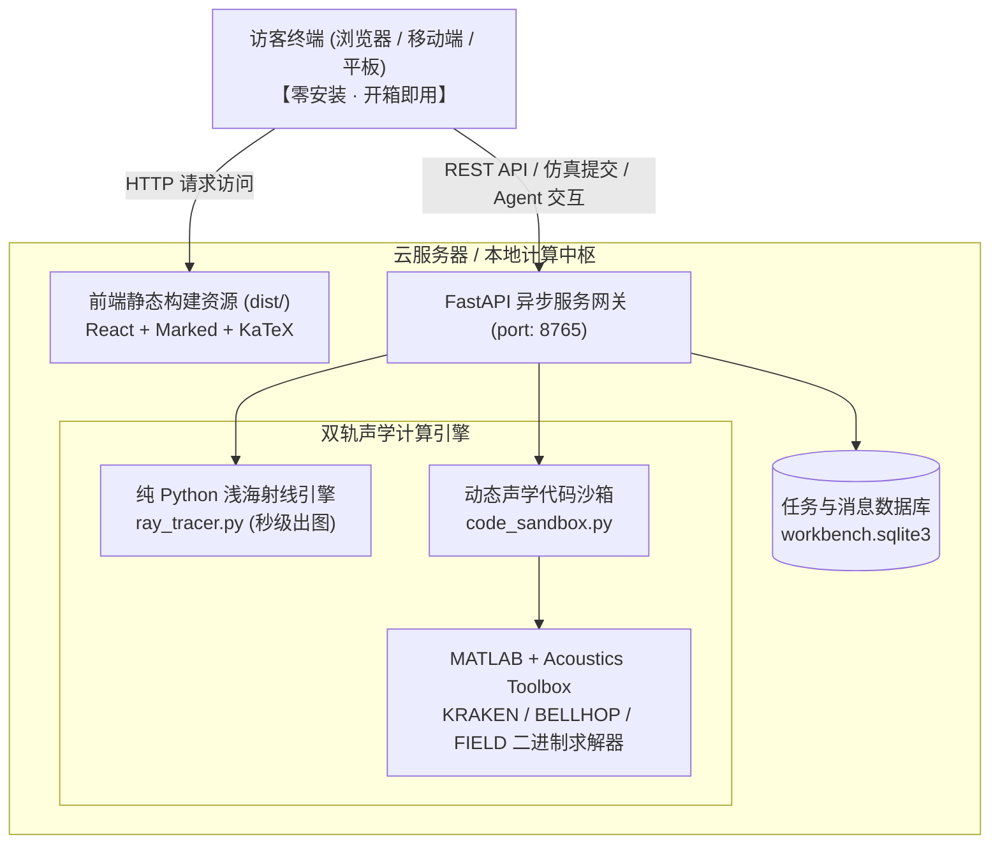

# 海洋声学智能体工作台 / Ocean Acoustics Agent Workbench

> 面向现代海洋声学课程设计的智能化计算工作台：结合课程知识图谱、自然语言 Agent 任务拆解编排、双轨声学求解引擎（纯 Python 射线追踪 + 本机 MATLAB Acoustics Toolbox 联合沙箱）与一键可视化声场分析。

---

## 🌟 核心特性与技术亮点

### 1. 🤖 开放式自然语言声学仿真智能体 (Open-Ended Simulation Agent)
- **自然语言意图理解与参数提取**：用户只需使用日常语言描述声学需求（如“*帮我仿真 50Hz 声源在水深 100m、声源 30m 处的浅海多途声线传播*”），系统自动提取环境水深、声源深度、掠射角、频率及距离等关键参数。
- **全自主动态建模与代码沙箱**：集成专用声学代码沙箱（`code_sandbox.py`），智能体可自主编写并执行 Python 或 MATLAB 脚本，自动加载 **Acoustics Toolbox (AT)** 环境变量与求解路径，完成开放式物理求解（如 **Pekeris 浅海波导模态分解**、**Rayleigh 海底反射损失**、**信道冲激响应 CIR** 等），彻底打破传统工具箱只能运行固定死板模板的限制。
- **多轮交互与机理分析**：计算完成后，智能体自动将生成的声场图表、传播损失曲线和到达数据嵌入对话，并结合波动声学与射线声学原理给出深度物理机理解读。

### 2. ⚡ 纯 Python 浅海射线声学引擎 (`ray_tracer.py`)
- **零商业软件依赖**：自研纯 Python 高精度解析几何与反射相图追踪算法，脱离 MATLAB 亦可独立高速运行。
- **反射相图与本征到达特征**：精确追踪任意掠射角（$0^\circ \sim 90^\circ$）下声线的海面（自由释放面，相位跃变 $\pi$）与海底（镜面全反射）反射总次数、末次反射跃度位置、终端剩余余量及到达深度。
- **自动图表与数据沉淀**：自动生成高分辨率声线轨迹图（`ray_trajectories.png`）和反射统计报表（`reflection_stats.csv`），支持完整结果包打包下载。

### 3. 🛠️ 交互式 MATLAB 与声学工具箱配置中心 (`MatlabPanel.jsx`)
- **智能路径探测**：后端提供全盘快速探测接口（`GET /api/matlab/detect`），自动扫描识别系统中已安装的 MATLAB 版本（如 `R2024b`、`R2024a`）及 Acoustics Toolbox 根目录，提供快捷预设候选。
- **7 大关键组件连通性自检**：在前端提供一键检测功能（`POST /api/matlab/check`），实时校验并展示状态绿灯芯片：
  - MATLAB 核心引擎（识别当前版本）
  - KRAKEN 简正波求解器 (`kraken.exe`)
  - BELLHOP 高斯光束 / 射线求解器 (`bellhop.exe`)
  - FIELD 声压场合成积分器 (`field.exe`)
  - SCOOTER 快速场 (FFP) 求解器 (`scooter.exe`)
  - AT 数据读写库 (`read_modes.m`, `read_shd.m`)
  - 基准环境算例 (`MunkK.env`)
- **云端部署无缝迁移**：部署到云服务器时，管理员可在 Web 界面直接配置路径或一键自动探测，彻底避免因服务器路径差异而硬编码修改配置文件的痛点。

### 4. 📐 工业级 Markdown 与 KaTeX 数学公式排版系统 (`MarkdownRenderer.jsx`)
- **完整 GFM 规范支持**：采用 Marked 解析引擎，完整渲染 Markdown 标题、强调、多级列表、代码块以及带浅蓝边框与斑马纹的精美数据表格。
- **本地离线 KaTeX 渲染**：本地内置 KaTeX 矢量字体库与样式表，零外网 CDN 依赖，平滑排版行内公式（`$...$`）与独立公式块（`$$...$$`），如掠射角 $\theta$、频散方程及声速剖面 $c(z)$。
- **交互式图表放大**：对话中输出的任何声学仿真图表均支持悬停动画并可点击唤起全屏遮罩放大查看。

### 5. 🌐 现代海洋声学课程知识图谱
- **立体化概念体系**：涵盖 6 个课程单元、46 个核心知识点、126 条有向关联关系，支持层级导航、最短概念路径查找及 3 条建议学习路线。
- **多源引用与教材原页链接**：关联经典教材《Computational Ocean Acoustics》原版 PDF 页面定位与原理示意图。

---

## 💻 架构设计与服务模式（“免客户端安装”）

本工作台采用**前后端分离 + 算力中枢服务**架构：



- **访客端（全员免装）**：所有编译代码均已打包进 `dist/`，任何用户（同学、老师、答辩评委）用浏览器打开 URL 即可直接使用，**客户端电脑不需要安装 Node.js、Python 或 MATLAB**。
- **服务端（算力中枢）**：由部署的主机（云服务器或本地工作站）集中执行科学计算与大模型调度，统一管理 MATLAB 路径与计算配额。

---

## 🚀 本地快速启动指南

### 1. 环境准备
- **Python**：3.10+（推荐 3.12）
- **Node.js**：20.19+（仅开发者需要编译前端时使用，普通运行可直接用已构建的 `dist/`）
- **MATLAB**：可选（若需运行简正波 KRAKEN 或 AT 深度仿真，推荐安装并配置 Acoustics Toolbox）

### 2. 一键启动
进入 `ocean-acoustic-workbench/ocean-acoustic-workbench` 目录：

```powershell
# 1. 运行预设启动脚本
.\start.ps1 -NoBrowser
```
或者在 Windows 环境下直接双击根目录中的：
`启动工作台.cmd`

启动后访问：**`http://127.0.0.1:8765/`** 即可进入工作台！

### 3. 自定义配置（Web 界面完成）
- 打开右上角顶栏的 **MATLAB 状态按钮** 或导航至 **环境配置**：
  - 点击「重新探测」自动匹配本机的 `matlab.exe` 与 AT 工具箱目录；
  - 点击「一键检测计算环境」确认各组件绿灯通过；
  - 在「云端模型与 API Key」中填入您的 DeepSeek / Qwen 等供应商 Key 即可启用大模型 Agent（未填 Key 时系统会自动切换至**离线智能体模式**，依然支持自然语言一键驱动仿真）。

---

## 🎯 自然语言仿真任务指令示例

进入工作台的 **“对话工作台”**，您可以直接输入以下开放式需求进行体验：

1. **浅海射线追踪与反射统计（脱水纯 Python 引擎）**：
   > “帮我用射线声学仿真浅海中的声线传播：水深 100m，海水声速 1500m/s，声源在水下 50m，发射 5°、15°、30°、45°、60° 掠射角的声线，计算传播到 5km 处的反射次数并画出轨迹图。”

2. **Pekeris 浅海波导模态求解（MATLAB + KRAKEN 沙箱）**：
   > “帮我用 MATLAB 调用 AT 工具箱的 KRAKEN 求解器，仿真一个经典 Pekeris 浅海波导：水深 100m，海水声速 1500m/s、密度 1.0g/cm³；半无限海底声速 1750m/s、密度 1.8g/cm³。计算 50Hz 时的传播模态阶数、水平波数及模态函数，画出前几阶简正波的深度分布曲线。”

3. **Munk 理想深海声道传播损失（深海简正波场计算）**：
   > “帮我仿真深海声道轴（源深 1000m）处 50Hz 声源在 50km 内的传播损失分布，接收器位于 1000m，画出二维 TL 声场分布彩图与曲线并分析物理机理。”

4. **多途信道冲激响应（CIR）**：
   > “用 MATLAB 仿真浅海多途声信道在 3km 处的到达结构：水深 100m，源深 30m，接收深 50m，计算直达声与各次界面反射声线的时延差与相对强度，生成多途时延柱状图。”

---

## 📁 项目目录结构

```text
现代海洋声学大作业/
├── ocean-acoustic-workbench/               # 核心项目主仓库
│   ├── backend/                           # FastAPI 后端服务体系
│   │   ├── app.py                         # 主路由网关、Agent 调度与环境检测 API
│   │   ├── code_sandbox.py                # 通用 Python / MATLAB 科学计算沙箱
│   │   ├── ray_tracer.py                  # 纯 Python 浅海射线声学求解引擎
│   │   ├── models.py                      # 大模型供应商适配层 (DeepSeek/Qwen/GLM/Kimi)
│   │   ├── knowledge.py                   # 课程知识图谱图数据结构与关系提取
│   │   └── requirements.txt               # 后端依赖配置
│   ├── src/                               # React 现代前端工程
│   │   ├── main.jsx                       # 应用顶层路由与工作台视图组合
│   │   ├── MatlabPanel.jsx                # MATLAB / AT 工具箱交互式配置面板
│   │   ├── MarkdownRenderer.jsx           # 集成 Marked + KaTeX 的专业排版组件
│   │   ├── ModelPanel.jsx                 # 大模型供应商与 API Key 管理面板
│   │   ├── GraphExplorer.jsx              # Cytoscape.js 交互式知识图谱浏览器
│   │   ├── style.css / matlab.css         # 现代化界面设计样式库
│   │   └── markdown.css                   # 声学排版与 KaTeX 样式表
│   ├── dist/                              # 前端生产打包静态资源 (免安装纯浏览器访问)
│   ├── .local/                            # 本地运行时配置与隔离工作区 (.gitignore)
│   │   ├── config.json                    # 本地持久化运行配置
│   │   ├── workbench.sqlite3              # 任务与会话数据库
│   │   └── runs/                          # 每次仿真的独立工况产物目录 (图表/日志/数据)
│   ├── package.json                       # 前端依赖配置
│   ├── start.ps1                          # PowerShell 启动脚本
│   └── 启动工作台.cmd                      # Windows 双击运行入口
└── docs/                                  # 架构设计、部署规范与验收说明
```

---

## 🛡️ 安全、沙箱隔离与版权声明

- **独立沙箱隔离**：每次计算任务均在 `.local/runs/<12位随机任务标识>` 独立临时目录中生成输入与脚本，严格防止污染系统环境变量与用户本地代码。
- **免敏感信息泄露**：用户的 API Key、本地路径及运行数据库仅驻留在本地 `.local/` 目录中，在 Git 中已被严格忽略，杜绝凭据误上传风险。
- **学术与教学合规**：本项目所有实现仅用于课程作业与教学演示，无任何商业盈利用途。
