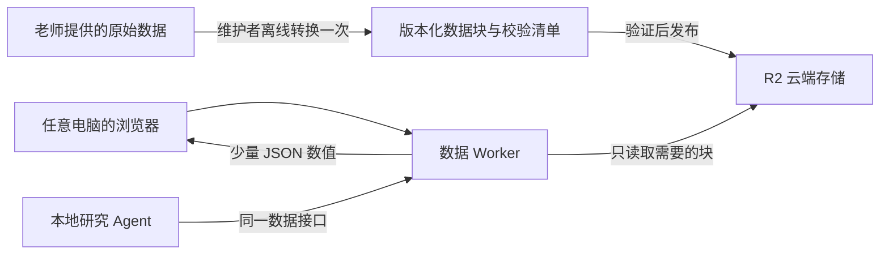

# 浏览器直接使用老师数据：云端海洋数据服务

## 用户体验与系统边界

用户打开数据站点即可缩放地图、选点、选月份/季节，查看温度、盐度、声速和海底高程；不需要下载 WOA18/ETOPO1 整包，也不需要本机 Python、MATLAB 或本地数据目录。

当前数据站点地址：<https://ocean-acoustic-data-workbench.huuiihhuuiii.chatgpt.site>。地址表示部署目标；实际数据是否发布成功请查看 `/api/ocean-data` 的 `available` 和 `version`，不要仅凭站点首页能打开判断数据已就绪。

数据发布者在自己的电脑离线读取原始资料，导出版本化小块，再一次性上传到云端 R2。线上 Worker 按坐标/时期读取必要小块，只返回当前查询的剖面或地形预览。发布完成后，维护者电脑关机不影响数据查询。MATLAB 声场计算仍需要相应计算节点，数据浏览不依赖它。



源码中的标准格式见 [`scripts/ocean_format.md`](../scripts/ocean_format.md)。当前使用 JSON/gzip 与 int16 数值块；未要求用户转换到其他海洋数据源，也未要求所有人下载原包。地图预览采用原数据降采样，点击水深使用原 1 角分地形；预览分辨率不等于温盐原始 1° 分辨率。

## 克隆用户：只使用已发布的数据

网页用户直接访问数据站点，无需以下配置。

本地运行研究工作台、希望 Agent 与网页使用同一批云端数据时，在启动后端前设置：

```powershell
$env:OCEAN_DATA_URL = 'https://ocean-acoustic-data-workbench.huuiihhuuiii.chatgpt.site'
```

`backend/ocean_data.py` 通过这一站点的 `/api/ocean-data`、`/api/ocean-data/profile`、`/api/ocean-data/terrain` 获取数据。云端不可达时给出错误，不静默改用别的气候态数据源。若需要回到本地模式，删除当前终端的环境变量，然后配置自己的 `ocean_data_path`：

```powershell
Remove-Item Env:OCEAN_DATA_URL -ErrorAction SilentlyContinue
```

## 数据发布者：生成自己的版本包

以下命令在仓库根目录执行。示例用本地工作台的虚拟环境，先安装 `ocean-acoustic-workbench/backend/requirements.txt` 中的 Python 依赖。数据目录应保留 `ssp/` 和 `terrain/ETOPO1_Bed_g_gmt4.grd` 结构。Windows 上若 NetCDF 不能读取中文路径，可使用已有英文目录联接；转换器不会修改原始资料。

来源路径的优先级为：

1. `--source` 显式路径；
2. 环境变量 `OCEAN_DATA_DIR`；
3. 当前仓库 `ocean-acoustic-workbench/.local/config.json` 中的 `ocean_data_path`。

配置中的相对路径以 `ocean-acoustic-workbench/` 为基准。未提供来源会明确要求设置来源，不再依赖维护者 Codex 工作区的目录。转换器只取数据路径，不打印完整私有配置。

先做小范围验证：

```powershell
.\ocean-acoustic-workbench\.venv\Scripts\python.exe scripts/export_ocean_data.py --source 'D:/ocean-data' --output '.local/ocean-cloud-sample' --periods 0,1,13 --bounds 119,121,19,21 --preview-strides 64,128
.\ocean-acoustic-workbench\.venv\Scripts\python.exe scripts/verify_ocean_data.py '.local/ocean-cloud-sample' --source 'D:/ocean-data'
```

再导出全部 17 个时期和全球地形：

```powershell
.\ocean-acoustic-workbench\.venv\Scripts\python.exe scripts/export_ocean_data.py --source 'D:/ocean-data'
.\ocean-acoustic-workbench\.venv\Scripts\python.exe scripts/verify_ocean_data.py '.local/ocean-cloud-export' --source 'D:/ocean-data' --global-points
```

默认输出为**当前仓库** `.local/ocean-cloud-export/`，已被 `.gitignore` 排除。也可以用 `--output` 指定其他位置。转换器遇到已有 manifest 默认拒绝覆盖；需要重新生成时使用不同目录，或明确使用 `--force`。固定版本的不同数据不能覆盖线上同名对象，应使用新版本。

验证器默认导入当前仓库的 `ocean-acoustic-workbench/backend/ocean_data.py`，比较时临时清除 `OCEAN_DATA_URL`，确保真正对照本地原始数据。验证结束恢复该进程的原环境变量。`--reader` 可以显式指定存档读取器，但不会导入或启动应用服务器。

## 格式与发布步骤

- WOA18：每期每 10×10 格点一块 gzip JSON，预计算现有 GSW 派生量；保留温盐原值及缺测掩码。月份深度轴与季节/年平均不同，未填补或外推。
- ETOPO1：300×300 原分辨率数值块，以有符号 little-endian int16 无损保存整数高程；转换时检查全网格是否能精确表示。
- 地图：4、16、64、128 倍步长的多级预览。最粗全球预览只有一块，避免一次请求拼接全球原始地形块。
- `manifest.json`：查询元数据与版本；`objects.json`：独立的对象 SHA256/大小清单；`verification.json`：本地验证证据。完整数据包 `complete=true` 才允许发布。

发布由维护者完成：构建/部署带海洋数据路由的 Worker → 配置受保护的发布凭据 → 上传清单内对象 → 校验所有远端对象 → 最后激活版本指针。不能先激活再补数据。当前上传器入口为：

```powershell
.\ocean-acoustic-workbench\.venv\Scripts\python.exe scripts/upload_ocean_data.py --data '.local/ocean-cloud-export' --site 'https://ocean-acoustic-data-workbench.huuiihhuuiii.chatgpt.site'
```

上传器可从 `DATA_PUBLISH_TOKEN` 或隐藏输入读取维护者发布凭据，支持已确认对象的断点续传；凭据不属于浏览器配置、数据包或 Git 仓库。公开源码不包含实际站点 hosting 身份和发布密钥。部署工作区/版本应独立审查；Git 提交或合并本身不会上传数据，也不会自动更新现有站点。

## 2026-11-01 本机全量导出与验证证据

版本：`woa18-etopo1-v1`。这是已完成的离线导出/校验记录；是否已上传并激活，以部署回执和在线接口为准。

| 项目 | 实测结果 |
|---|---|
| 数据对象 | 13,985 个 |
| 数据对象总字节 | 2,308,803,300 B，约 2.309 GB |
| 分组 | 温盐 11,016 块；原地形 2,701 块；预览 263 块；坐标对象 5 个 |
| 查询 manifest | 18,456 B |
| 对象清单 | 2,323,997 B |
| 全部导出对象 SHA256 | 13,985 项通过 |
| 原始来源文件 SHA256 | 35 项通过 |
| 剖面对照 | 11 个位置 × 17 期 = 187 条，其中 136 条成功剖面逐值完全相等，51 条预期错误与原读取器一致 |
| 温盐原值/掩码 | 374 次逐值对照通过 |
| 水深 | 11 点原分辨率高程一致 |
| 预览 | 四级共 12 个采样点与原地形取样一致 |
| GSW | 3.6.23 |

测试位置包含南海格点平局、非平局点、不同半球、日期线 ±180°、陆地和极点。这里验证了存储转换与既有读取行为的一致性，不能据此宣称所有海域的海洋环境或声场物理精度已获证明。

当次导出的主 manifest SHA256：

```text
5d2f48f525fcc6338c95dc244e6dcf3a9cb71f311fe519f035191518f3b7514e
```

对象清单 SHA256：

```text
1ad631250e7ce77fb8d0809db5ff1d88076fb2c5870053830a26789fa8b25723
```

## 转换器版本溯源

当次全量导出所记录的转换器 SHA256 是：

```text
e4034e913513e4813a2951fd5185477f9ad8d26017a09bbd97c9f694de7c98f7
```

其后为 GitHub 克隆用户改进了默认路径发现和验证器本地模式隔离，当前脚本哈希因此不同；**没有重写当次导出的 manifest，也没有重新导出全部数据以伪装哈希一致**。维护者已将该哈希对应的原脚本快照另存于私有导出溯源目录，复核发布数据时应使用 manifest 所记的快照/历史源版本；不要只拿工作区最新版脚本的 SHA 与旧数据包比较。

## 上线验收

1. 从没有老师原始数据的电脑/干净浏览器打开网页，可完成新的选点与月份查询。
2. 维护者电脑关机后，新查询仍可用；不能用浏览器旧缓存证明服务独立。
3. 选点返回实际 WOA 格点、请求点海底与温盐格点海底、数据版本、原始来源说明；地图提供合适层级，拖动时取消过时请求。
4. 不会请求原始整包或整幅全球高分辨率网格；弱网/失败显示真实错误，结果不伪装成实时观测。
5. 研究 Agent 通过 `OCEAN_DATA_URL` 使用同一已发布版本；声场任务仍冻结实际使用的剖面，不因以后更新在线数据而改变旧输入。
